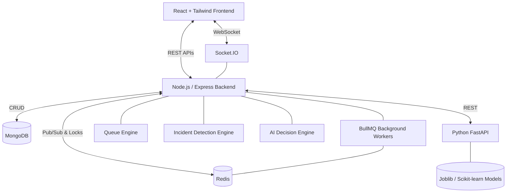

# GridWise — System Architecture

This document maps out the comprehensive structure of the GridWise application following the integration of all ML, real-time, and AI decision systems up to Step 33.

## 1. High-Level Architecture Diagram

## 2. Core Modules

### 2.1 Frontend (React + TypeScript)
- **Framework**: React 18, Vite, TypeScript.
- **Styling**: Tailwind CSS, Lucide Icons.
- **Routing**: React Router (`/fleet`, `/revenue`, `/ai-recommendations`, `/maintenance`).
- **Real-time**: `socket.io-client` hook for instant UI reactivity.

### 2.2 Backend API (Node.js + Express)
- **Language**: TypeScript.
- **Key Routes**:
  - `/api/queue` - Live queue management.
  - `/api/bookings` - Station ranking and intelligent scheduling.
  - `/api/incidents` - Deduplicated operational incident tracking.
  - `/api/decisions` - AI automation tracking and manual admin overrides.
- **Key Services**:
  - `queueService.ts`: Redis ZSET backed FIFO queues.
  - `recommendationService.ts`: Multi-factor station ranking.
  - `incidentDetectionService.ts`: Translates raw events into `Incident` documents.
  - `decisionEngine.ts`: Deterministic rule evaluator yielding concrete actions.
  - `actionExecutor.ts`: Executes decisions while enforcing safety boundaries.

### 2.3 Real-Time State (Redis)
- **Live Queue**: Sorted Sets (`zadd`, `zrank`) for instant queue positions.
- **Idempotency**: Distributed locks (`setnx`) to guarantee event uniqueness.
- **Caching**: 5-minute TTL caches for ML inferences (Wait time, Demand).

### 2.4 Message Broker & Background Jobs (BullMQ)
- **Queues**:
  - `incidentQueue`: Async evaluations of charger faults.
  - `notificationQueue`: Async delivery of user notifications.
  - `decisionQueue`: Offloaded execution of the deterministic AI rules engine.

### 2.5 Machine Learning Service (Python + FastAPI)
- **Endpoints**:
  - `/predict/queue`
  - `/predict/demand`
  - `/predict/maintenance`
- **Models**: Built on real cleaned data using `scikit-learn` and `XGBoost`. Saved as `.joblib` models or statistical metadata files (e.g., `demand_model.joblib`).

### 2.6 Persistence Layer (MongoDB)
- **Mongoose Models**:
  - `Station`, `Charger`, `Vehicle`, `User`, `Booking`
  - `Incident`, `AuditLog`, `AIPrediction`, `DecisionLog`, `QueueHistory`
